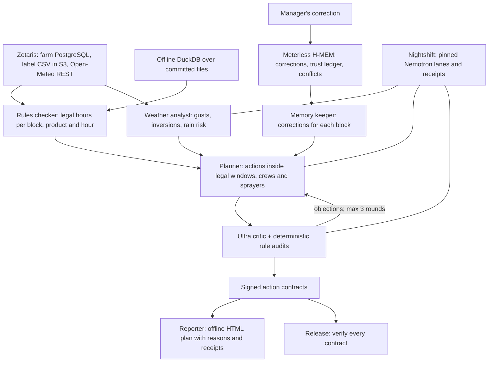

# Spray Window

Spray Window plans a farm's next 48 hours every morning: which blocks to **spray, irrigate or hold**, and when. It checks the live forecast against real EPA pesticide labels, the crews and equipment on hand, and the local rules people teach it. Every action gets a time window, a crew, a sprayer, its reasons and a signed contract. It proposes work orders; it does not operate equipment, and a certified applicator makes the final call.

The demo farm (five almond and pistachio blocks near Fresno, California) is **fictional**. The pesticide label values are real, taken from EPA-accepted labels, and the forecast is the real Open-Meteo forecast for that location.

## Try it without credentials

Use Node.js 20 or later and npm. In a clone of this repository:

```sh
npm install
npm run demo
```

No `.env`, Docker, Zetaris or Nightshift account is needed. DuckDB reads the committed data files, the real agents execute, and model replies recorded live from Nightshift replay only when the entire request matches. The demo runs in about a second:

1. **Session 1** plans the 48 hours: two irrigations, then five sprays, approved by the Ultra critic after two rounds of objections.
2. **A person records a correction:** "Never spray Block B01 before 08:00; the school bus passes at 07:30."
3. **Session 2** plans again on the same forecast. North 40's spray is reasoned against the correction ("memory mem-1 respected: spray starts after 08:00"), the critic confirms it, and the action carries the memory ID and its trust-ledger entry. Code then moves one spray by an hour to stay within the two ready sprayers.
4. **Release** verifies every signed action contract and releases all seven actions.

Each plan is a self-contained HTML page under `runs/`, with the block map, actions by day, rule checks, cited memories, the critic's notes, weather flags, model receipts and the full trace. Open it directly in a browser.

## Why the decision is hard

One morning's plan has to satisfy several rule sets at once:

| Label (EPA reg. no.) | Wind | Rain-free | Re-entry | Before harvest | Buffer |
|---|---|---|---|---|---|
| Altacor (352-730) | 3–10 mph (advisory) | not stated | 4 h | 10 days | 100 ft from water |
| Delegate WG (62719-541) | max 15 mph | not stated | 4 h | 1 day | not stated |
| Quash, metconazole (59639-147) | 2–10 mph | 2 h | 12 h | 25 days | not stated |
| Esteem Ant Bait (59639-114) | not stated | 6 h | 12 h | 1 day | not stated |

Values come from each label's tree-nut section; the full table with label links is in [data/README.md](data/README.md). Five blocks × 48 hours × 6 label rules is **1,440 rule checks** every morning, before crews, equipment, schools, creeks and the manager's own rules are considered. Done by hand, that is roughly an hour of cross-checking each morning (our estimate).

## Live setup

Install Zetaris Docker separately, and configure a Nightshift runtime with the NVIDIA provider. Fill a local `.env` from the placeholders in `.env.example`; do not commit it. Spray Window reuses the PostgreSQL and S3-compatible (SeaweedFS) containers from its sibling project [Lotline](https://github.com/calledAdo/lotline):

```sh
cp .env.example .env
# Fill in credentials locally before continuing.
npm install
npm run data:seed && npm run data:weather && npm run data:upload && npm run setup:zetaris
npm run spray -- plan
```

`data:seed` writes the fictional farm to the `farm` PostgreSQL database and to `data/sources/`. `data:weather` fetches the Open-Meteo forecast snapshot. `data:upload` puts the label rules and snapshot under `s3://lotline/spraywindow/`. `setup:zetaris` registers every source and creates five non-admin users and roles, one per agent (`sw_rules_checker`, `sw_weather_analyst`, `sw_memory_keeper`, `sw_planner`, `sw_critic`), each with SELECT on its own tables only. Generated passwords are written only to `.env`. See [the principal policy](src/data/policy.ts) and [the DCL](scripts/setup_zetaris_principals.sql).

## Commands

```sh
npm run spray -- plan                                      # today's 48-hour plan
npm run spray -- correct "Never before 08:00" --block B01  # record a correction
npm run spray -- watch                                     # re-plan and show what changed since the last saved plan
npm run spray -- release                                   # verify contracts, then release
npm run record:cassettes                                   # record a live run for offline replay
```

Prefix commands with `SAMPLE_MODE=true` for offline operation. `--today YYYY-MM-DD` (or `SPRAY_TODAY`) sets the planning date. Memory is stored durably in `.memory/`, or in `SPRAY_MEMORY_DIR`. `release` refuses the whole release if the critic did not approve the plan, or if any action's contract is missing, was signed for a different version of the action, has an invalid signature, or has expired. `watch` compares the new plan with the last saved one and prints, per block, what moved and which forecast hours changed; the plan page shows the same under "What changed since the last plan".

## Architecture



| Agent | Runs on | Job |
|---|---|---|
| Rules checker | Code only | Computes every legal hour from the forecast and the label limits. The AI never decides what is legal. |
| Weather analyst | Nemotron 3.5 Lightning | Flags gust spread, calm-wind inversion risk and rain probability as structured flags. |
| Memory keeper | Meterless H-MEM | Retrieves each block's corrections, plus related memories, with provenance. |
| Planner | Lightning, then Ultra for revisions | Proposes the plan inside the legal windows, crew shifts and equipment. |
| Critic | Nemotron 3 Ultra + code audits | Challenges the plan against rules, memories and buffers, and sends it back for up to three rounds. Code audits block illegal, off-shift, over-rate and overbooked actions even without the model. |
| Reporter | Code only | Renders the plan page with every reason, check, memory and receipt. |

After the model review, deterministic code audits hold every plan to the same bar, whether or not the Ultra critic is available. They block a spray outside a legal window computed by the rules checker (not one the model claims), any action outside a qualified crew member's shift, a rate above the label maximum or in the wrong unit, more simultaneous sprays than applicators or ready sprayers, and, when the Ultra critic is unavailable, any action on a block with a recorded correction, which a person must confirm. If the only blockers left after three rounds are scheduling clashes found by code in a plan the model critic did not block, code moves the clashing sprays (never one on a block with a correction) to the nearest legal, on-shift hour within capacity, re-signs them and re-runs every audit. Otherwise the plan is marked "requires attention" and cannot be released. Spray rates always come from the block's planned rate, never from the model. If the planner model is unavailable, a code planner books the earliest hour that is legal and has a certified crew member and a sprayer free.

Where a label states no value, the rules checker applies a named farm-policy default (wind 2–10 mph, 4 rain-free hours) and every check says whether the label or farm policy set the limit. Rain is checked across the whole rain-free period after the application hour. Every action's contract is an HMAC-SHA256 over a hash of the action itself (kind, block, times, product and rate) and of its block, label, weather, memories and plan context. The signing key comes from `SPRAY_CONTRACT_SECRET`, or from a random key kept beside the local memory store.

## Sponsor technology

**Zetaris.** One governed data layer over three kinds of source: a PostgreSQL datasource (`farm`: blocks, crew, equipment, past applications), Lightning filestore tables in object storage (`products.label_rules` as CSV, `weather_snap.forecast_snapshot` as JSON), and a Lightning REST table over the live Open-Meteo API, flattened by the SchemaStore view `weather_views.forecast`. Each agent queries as its own least-privilege user.

**Meterless H-MEM.** The Apache-2.0 reference at upstream commit `1742dec56a66e58eef9dda2d2b865823758ca8cd` is vendored in [engines/hmem](engines/hmem/), with its LICENSE, NOTICE and upstream commit. Spray Window uses its durable JSON state and append-only trust ledger, retrieval with reinjection into the planner's prompt, and conflict detection between an old rule and a new correction. The upstream conformance suite runs unmodified against the adapter.

**Nightshift and NVIDIA.** Every model request goes through Nightshift's OpenAI-compatible `/chat/completions` API, with the models pinned by name: `nvidia/nemotron-3.5-lightning-30b-a3b` for the weather analyst and first plan (with `chat_template_kwargs.enable_thinking=false` for structured output), and `nvidia/nemotron-3-ultra-550b-a55b` for revisions and critique. Generic routing aliases are deliberately avoided. Each call records its receipt ID, routed model, provider, latency, tokens and cost, and the plan page lists them.

See [the standalone sponsor explanation](docs/sponsor-tech.md).

### Where the engine is used (judges look here)

| Feature | Engine use | Code |
|---|---|---|
| Record a person's correction | `add` with provenance; ledger `create` entry | `src/agents/memory_keeper.ts` |
| Corrections for each block | Tag lookup plus `query` retrieval; ledger `read` entries | `src/agents/memory_keeper.ts` |
| Plan changes because of memory | Retrieved memories reinjected into the planner prompt and cited per action | `src/agents/planner.ts`, `src/orchestrator.ts` |
| Old rule versus new correction | `conflicts.scan` and `autoResolve`, logged to the ledger | `src/agents/memory_keeper.ts` |
| Durable across runs | JSON state and append-only ledger in `.memory/` | `engines/hmem/reference/src/memoryStore.ts` |
| Memory cited on the plan page | Memory ID and ledger entry per action | `src/agents/reporter.ts` |

## Evaluation

```sh
npm run typecheck
npm test
npm run engine:conformance
npm run demo
```

- **Tests:** 36 offline tests cover legal windows, the pre-harvest deadline, rain inside the rain-free period, unstated label values, the code audits (legal window, crew shift, label rate, sprayer capacity, corrections without the model critic, wall-clock time formats), the scheduling repair, contract signing and release refusals (including an action edited after signing), the memory demo, re-plan staleness and plan diffs. All pass.
- **H-MEM conformance:** 13/13 upstream checks pass (record validation, feedback deltas, ranking order, sleep guardrails, conflict gate, ledger audit, dream boundary).
- **Live runs:** two sessions recorded on 27 October 2026 against Zetaris and Nightshift, in `data/cassettes/`: 8 and 10 Nemotron calls, all HTTP 200 with receipts. Session 1: the critic objected in rounds 1 and 2 (the code audit caught overbooked sprayers) and approved in round 3. Session 2, after the B01 correction and on the same forecast (`SPRAY_FORECAST_SOURCE=snapshot`): Ultra approved in round 3; the code audit still found one spray beyond sprayer capacity, and the scheduling repair moved it by an hour. Ultra plan revisions took up to 250 seconds and up to 16,000 output tokens, so the deep lane allows 8 minutes per call (`LLM_TIMEOUT_MS_DEEP`). The offline demo replays both sessions with no fallbacks. The demo video shows an earlier recording, in which session 1 placed B01 at 07:15 and the correction moved it to 08:06.

## Data, licences and pre-existing work

[Data sources](data/README.md) lists every label value with its PPLS link. EPA labels are US Government works; the Open-Meteo forecast is CC BY 4.0; the farm records are synthetic. No personal data is included.

The Meterless H-MEM reference is the declared pre-existing component, retained under Apache-2.0. Spray Window reuses patterns from its sibling project Lotline (the Zetaris client, Nightshift client and record/replay design), written by the same author during the same build window. Package dependencies are third-party components listed in the lockfile.

## Limitations and security

- **Advisory only.** Follow the pesticide label; the label is the law. A certified applicator must confirm weather, rates, buffers, re-entry and pre-harvest intervals, and local restrictions before any application.
- The farm is fictional, and the label table covers six products for tree nuts. Labels change; check the current label.
- The forecast is a model, not an on-site measurement. Wind direction is used for buffers, but drift also depends on droplet size and equipment.
- `watch` re-plans the whole 48 hours on the current forecast and memories, then reports what changed per block; it does not re-derive only the affected actions.
- Models can disagree, time out or return invalid JSON. Revisions stop after three rounds; unresolved objections are left for a person. Fallbacks are labelled in the trace.
- Per-agent SELECT grants are enforced by Zetaris, and by a shared allowlist in DuckDB. This is application access control, not isolation from a developer who can read `.env`.
- Memory is single-user local storage. A shared deployment needs a shared store and access control.
- `.env`, `.memory/`, runs and dependencies are ignored. Recorded cassettes contain model request and response bodies only, never authorization headers.

## Licence

Apache-2.0. See [LICENSE](LICENSE).
